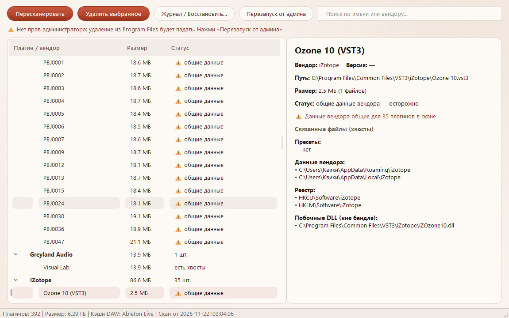

# VST3 Manager

Менеджер и клинер VST3-плагинов для Windows: сканирует систему, показывает
все «хвосты» каждого плагина (пресеты, данные вендора, ключи реестра, побочные
DLL, кэши DAW) и удаляет плагины безопасно — с ZIP-бэкапом, в корзину и с
возможностью полного восстановления.



## Возможности

- **Скан** всех стандартных папок VST3 (`Program Files`, per-user, `x86`) +
  кастомные пути из реестра (`HKLM/HKCU\Software\VST\VST3Path`)
- **Карточка плагина**: вендор, версия, размер, связанные файлы
- **Хвосты плагина**:
  - пресеты (`Documents\VST3 Presets\<Vendor>`)
  - данные вендора (`AppData`, `ProgramData`)
  - ключи реестра (`HKCU/HKLM\Software\<Vendor>`)
  - побочные DLL вне бандла — находятся через таблицу PE-импортов **и** по
    строкам бинарника (ловит зависимости, подгружаемые через LoadLibrary)
- **Чистка кэшей DAW**: REAPER (`reaper-vstplugins64.ini` — вырезаются секции
  удалённого плагина), FL Studio (Plugin database); Ableton и прочие
  пересканируют сами
- **Безопасное удаление**: всё попадает в ZIP-бэкап → затем в корзину → запись
  в журнал. Восстановление в один клик из журнала (включая импорт реестра и
  возврат ini)
- **Общие данные вендора** помечаются предупреждением и по умолчанию не
  удаляются (у Arturia/Antares/iZotope и т.п. одни данные на десятки плагинов)
- Тема интерфейса **Bloom** (по спецификации
  [hallmark](https://github.com/nutlope/hallmark)): тёплая бумага,
  терракотовые «резиновые» кнопки, два неподвижных световых «блума»

## Запуск

Нужен Python 3.10+:

```bash
python -m pip install PySide6 send2trash pefile
python vst3manager/main.py
```

Для удаления из `Program Files` жми «Перезапуск от админа» в окне программы.

## Сборка в .exe

```bash
python -m pip install pyinstaller
python -m PyInstaller --onefile --windowed --name VST3Manager --paths vst3manager vst3manager/main.py
# → dist/VST3Manager.exe
```

## Тесты

```bash
python test_cleaner.py                 # e2e: бэкап → корзина → реестр → ini → restore
python vst3manager/main.py --selftest  # скан + построение UI без окна
```

E2E-тест полностью работает во временной папке — реальные плагины не
затрагиваются.

## Структура

```
vst3manager/
  main.py     — точка входа (--selftest, --shot)
  scanner.py  — скан бандлов, moduleinfo.json, PE-ресурсы, побочные DLL
  cleaner.py  — ZIP-бэкап, корзина, журнал, восстановление, ini/реестр
  daw.py      — кэши DAW (REAPER, FL Studio)
  ui.py       — интерфейс (PySide6)
  theme.py    — тема Bloom (oklch-токены → QSS)
```

## Безопасность

- Ничего не удаляется в обход корзины; всегда сначала бэкап.
- Общие папки вендора и ключи реестра (могут хранить лицензии) — сняты по
  умолчанию.
- Журнал операций: `%APPDATA%\VST3Manager\journal.json`,
  бэкапы: `%APPDATA%\VST3Manager\backups\`.
